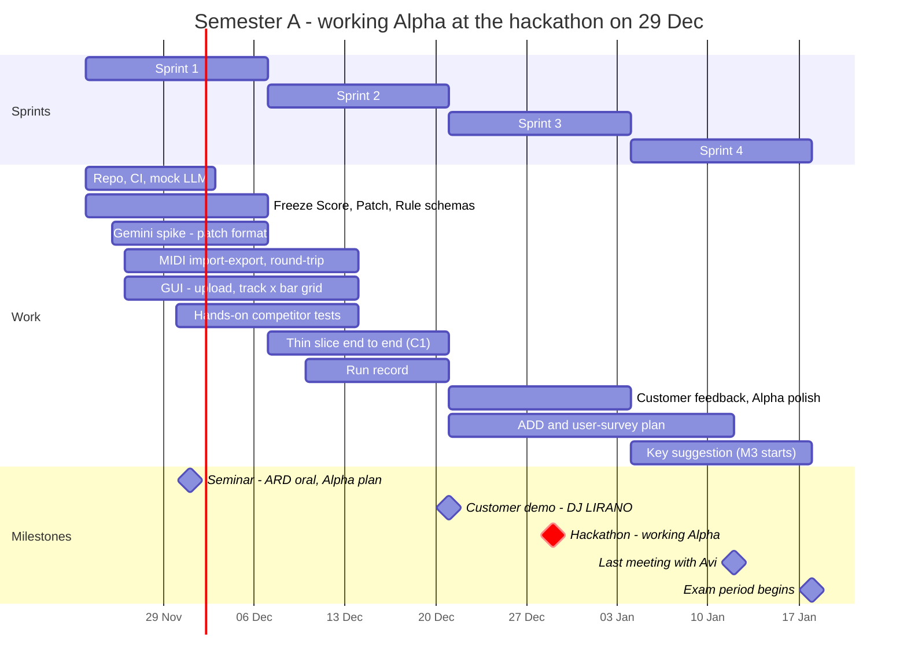
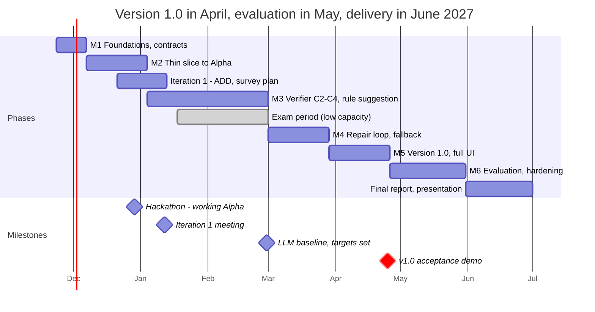

# Co-Hendrix – Development Plan

Last updated: 22 Nov 2026 · Owner: Eden

The team chose method C: until the hackathon on 29 Dec 2026 we build one thin end-to-end slice together, and after it each member owns one functional area end to end. This doc grows step by step: method, challenges and the Gantt are done; the Sprint 1 issues are drafted in [`sprint-1-issues.md`](sprint-1-issues.md) for team approval.

## Working method

We work in two-week sprints in two phases: a shared walking skeleton first, then feature ownership.

| Phase | When | How we work |
| --- | --- | --- |
| 1 · Walking skeleton | Now → hackathon, 29 Dec | The whole team builds the Alpha slice from ARD 5.2: one real file, one constraint (C1), one real LLM, through every module. Each member builds one layer of the same slice. The Score and Patch schemas are frozen first. |
| 2 · Feature ownership | After the hackathon → June 2027 | Each member owns one functional area end to end — UI, logic, tests and maintenance — and stewards one shared component. |

**Alignment with Avi's email.** On 1 Dec we present the Alpha *plan* and what exists so far. The working Alpha is shown at the hackathon, after a first demo to the customer. ARD Chapter 5 says "Alpha, week 7"; we should present it as "Alpha planned for week 7, working by the hackathon" and fix Table 7 if needed.

**Feature areas (phase 2, owners to be decided).** The split follows the ARD's functional areas and pairs each area with the shared component closest to it, so the load is roughly even.

| Area | ARD requirements | Shared component the owner stewards | Owner |
| --- | --- | --- | --- |
| Verification and repair | FR4, FR12, FR13, FR17 | Verifier (rule checks) | TBD |
| Rules and sketch input | FR1, FR7, FR8–FR11, FR14–FR16, FR25 | MIDI engine (Score model, import/export, key/range/grid extraction) | TBD |
| Region, review and export | FR2, FR5, FR6, FR19–FR21 | Web client (UI shell, region selection, playback) | TBD |
| Windows, models and run records | FR3, FR18, FR22–FR24, FR26 | API, database, LLM gateway, CI | TBD |

**Team rules.**

- **Definition of done:** merged to main, tests written and passing in CI, reviewed by someone other than the author, shown at the sprint review.
- **Reviews:** every PR is reviewed by a non-owner. A PR that touches a shared component also needs that component's steward.
- **Schemas:** the Score, Patch and Rule schemas change only through a PR approved by all four stewards, with contract tests in CI.
- **AI-assisted code:** allowed, but the author must be able to explain every line, and tests are mandatory.
- **Sprint rhythm:** planning at the start, review with a demo and a short retro at the end; the customer joins the review when possible.

## Challenges and how we cope

The hardest challenges are getting the LLM to return patches in our format, real-world MIDI files, and integrating four people's work into one pipeline. Each row names the ARD risk it relates to, and the signal that tells us the challenge is handled.

**Technical challenges**

| # | Challenge | Why it is hard here | How we cope | Handled when | ARD |
| --- | --- | --- | --- | --- | --- |
| T1 | The LLM returns a patch in our format | An LLM writes text. It may return broken structure, missing fields or notes outside the region, and each bad reply uses one of the 4 calls (NFR5). | Ask for structured output against our Patch schema; validate it in code before the verifier; a reply that does not parse counts as a failed check and goes to repair with the parse error. A short spike with real calls before the hackathon. | The spike shows the parse rate, and a parse failure ends in repair or abstain, never in a crash. | R1 |
| T2 | LLM patches break the rules | The LLM is not bound to follow instructions (ARD 1.1). | Repair loop with the exact violations (FR17); only the context the request needs; template-composer fallback behind the same Patch format. | Sprint 5 baseline measures the delivery rate against the provisional ≥ 70%. | R1 |
| T3 | Real DAW files are messy | DAWs export differently: type 0 vs type 1, different tick resolutions, overlapping notes, notes that cross bar edges, drums on channel 10. | One normalised Score model inside the system; collect 5–10 real exports from DJ LIRANO now; import → export → compare tests in CI. | Every customer file round-trips unchanged (NFR10). | R6 |
| T4 | Exact diff and "nothing else changed" | Showing added, removed and changed notes (FR19) and proving FR4 needs stable note identity, and the LLM cannot be trusted to keep it. | The Patch references note IDs that our code assigns; the verifier also compares the full note sets outside the region; property tests with 10,000 random patches (NFR6). | Patch schema frozen; property tests green in CI. | R6 |
| T5 | The 60-second limit with up to 4 LLM calls | Every call takes seconds, and repairs add calls (NFR2). | A timeout per call; before each repair, check the time left; small prompts; a fast default model (FR24). | Request times in run records stay under 60 s in the Sprint 5 baseline. | R5 |
| T6 | A browser GUI for region selection, diff and playback | It is a substantial front-end, and the customer needs to see something early. | Start with a simple track × bar grid, not a piano roll; add playback (FR21) after the hackathon. | At the hackathon the customer selects a region and sees the change. | — |
| T7 | Key suggestion on short or sparse sketches | Few notes, and tracks that disagree. | Top-3 keys when there is no common key; manual entry always possible (FR10 note). | Labelled fixtures in Sprint 5. | R4 |

**Team and process challenges**

| # | Challenge | How we cope | Handled when | ARD |
| --- | --- | --- | --- | --- |
| P1 | Four people, one pipeline | Walking skeleton first; frozen schemas; contract tests and CI from the first sprint; merge to main often. | The Alpha runs end to end in CI with a mock LLM. | R6 |
| P2 | Courses and the exam period (Jan–Feb) overlap M3 | Plan lower capacity in exam weeks; commit only to what fits; unfinished work stays visible on the board. | Each sprint review compares planned work with done work. | — |
| P3 | Knowledge silos once each member owns an area | Non-owner reviews; the sprint demo is presented by a different member each time. | Every member can explain every area (oral exams). | — |
| P4 | Customer feedback before the hackathon | Book a demo slot with DJ LIRANO now; a review every sprint after that; log feedback as issues. | Demo held before 29 Dec, feedback on the board. | R7 |
| P5 | Open decisions block real-LLM work | Decide the development LLM provider, who pays, and a budget cap; use the mock LLM in CI meanwhile. | Decisions recorded (see below). | R5 |
| P6 | Developing with AI tools | The team rule above: the author explains every line, tests are mandatory. | Reviews reject code its author cannot explain. | — |

## Slide version for 1 Dec

Five lines for the "Challenges" slide of the Alpha presentation, one idea per line. The tables above are the backup for questions.

| Challenge | How we cope |
| --- | --- |
| LLM replies in our patch format | Structured output, validated in code; a bad reply goes to repair |
| LLM breaks the rules | Repair with the exact violations; verified template fallback |
| Real DAW files are messy | One normalised Score model; customer files tested in CI |
| Four developers, one pipeline | Walking skeleton first; frozen schemas; contract tests |
| 60-second limit, up to 4 calls | Timeout per call; small prompts; fast default model |

## Gantt — Semester A

We start from an empty repository on 23 Nov, so Sprint 1 builds the foundations and Sprint 2 joins them into one thin slice that is ready for the customer demo on 21 Dec.

| Sprint | Dates | Goal |
| --- | --- | --- |
| Sprint 1 | 23 Nov – 6 Dec | Foundations: repo, CI with a mock LLM, frozen schemas, MIDI import/export, first GUI screen, Gemini spike. On 1 Dec we show the plan and whatever runs by then. |
| Sprint 2 | 7 Dec – 20 Dec | Thin slice end to end: upload → lock a region → Gemini patch → C1 check or abstain → diff → export, with a run record. Demo-ready by 20 Dec. |
| Sprint 3 | 21 Dec – 3 Jan | Customer demo on 21 Dec; fix what the customer finds; working Alpha at the hackathon on 29 Dec. Start the ADD. Decide the area owners. |
| Sprint 4 | 4 Jan – 17 Jan | Phase 2 begins. Finish the ADD and user-survey plan for the 12 Jan meeting; start key suggestion (M3). |

## Gantt — whole project

The ARD's milestones M1–M6 keep their content but move to the real calendar: the project started three weeks later than ARD Table 7 assumed, and the exam period takes six weeks out of M3.

Semester B is assumed to start on 1 Mar 2027.

| Milestone | When | Content | Change from ARD Table 7 |
| --- | --- | --- | --- |
| M1 Foundations | Sprint 1 · 23 Nov – 6 Dec | Repo, CI, mock LLM, frozen schemas, Gemini spike, competitor tests | Starts 23 Nov, not early November |
| M2 Thin slice → Alpha | Sprints 2–3 · to 3 Jan | One region edit with C1, diff, export, run record; customer demo 21 Dec; hackathon 29 Dec | Working Alpha at the hackathon, not in week 7 |
| M3 Verifier and rules | Sprint 4 + exam period · to 28 Feb | Key, range and grid checks with fixtures and mutants; rule suggestion; raw-LLM baseline | Stretched over the exam period at low capacity |
| M4 Repair loop | Mar | Repair loop, template-composer fallback, verbal constraints | One month later |
| M5 Version 1.0 | Apr | Chat windows, model choice, playback, history; acceptance demo with the customer | One month later |
| M6 Evaluation | May | Measured-quality suite, blind comparison, user study, hardening | Shortened to five weeks |
| Final delivery | Jun | Final report and presentation | Unchanged |

**Exam period, 18 Jan – 28 Feb.** We plan it at low capacity, with work that one person can do alone and that does not block others: the key, range and grid checks with their fixtures and mutants, and the raw-LLM baseline. Nothing in this period depends on a meeting of the whole team.

**Buffer.** The plan has no slack between M4 and M6. If a milestone slips, the possible upgrades (EXT1–EXT4) are dropped first, then the template-composer fallback is reduced to one pattern.

## Sprint 1 issues

The Sprint 1 goal is broken into 21 issues to open (S1-02 to S1-22), assigned by layer to Member 1–4 until owners are decided: [`sprint-1-issues.md`](sprint-1-issues.md). The tech stack (S1-01) was decided on 22 Nov 2026 as listed in ARD 4.2 ([ADR 0013](../decisions/0013-tech-stack-as-in-ard.md)).

## Decisions

Most planning questions were answered on 23 Nov 2026; three are still open.

| Question | Answer |
| --- | --- |
| Sprint calendar | Sprint 1 starts Mon 23 Nov 2026; two-week sprints |
| What exists already | Nothing yet — Sprint 1 starts from an empty repository |
| Development LLM | Gemini, with a total budget of $100 |
| Tech stack | As listed in ARD 4.2 (ADR 0013, 22 Nov 2026) |
| Customer demo | 21 Dec 2026, with DJ LIRANO |
| Semester A | Last meeting with Avi on 12 Jan 2027; exam period 18 Jan – 28 Feb 2027 |

**Budget.** $100 must last the year, so CI and day-to-day development use the mock LLM, and real Gemini runs are made on purpose and logged. The Sprint 1 spike records the cost of each call; from it we compute how many real requests the budget allows, and set a cap per request.

**Still open**

- [ ] Owners of the four feature areas — needed by the end of Sprint 3, before phase 2 starts on 4 Jan
- [ ] Who holds the Gemini API key and billing
- [ ] Semester B start date — the plan assumes 1 Mar 2027
