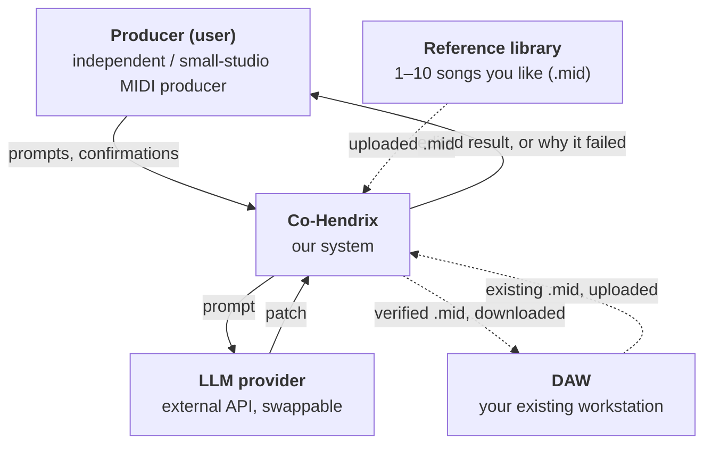
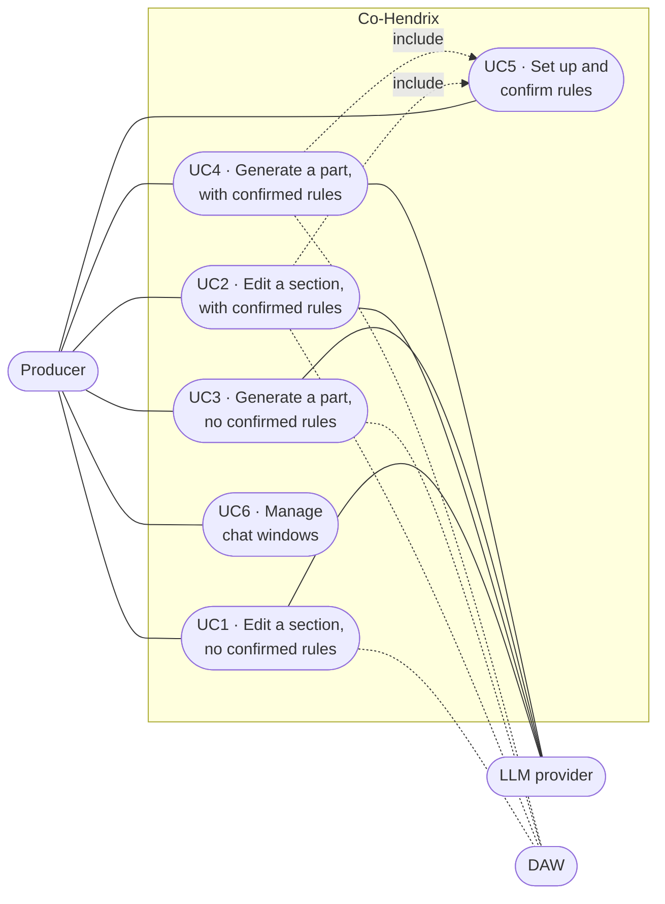
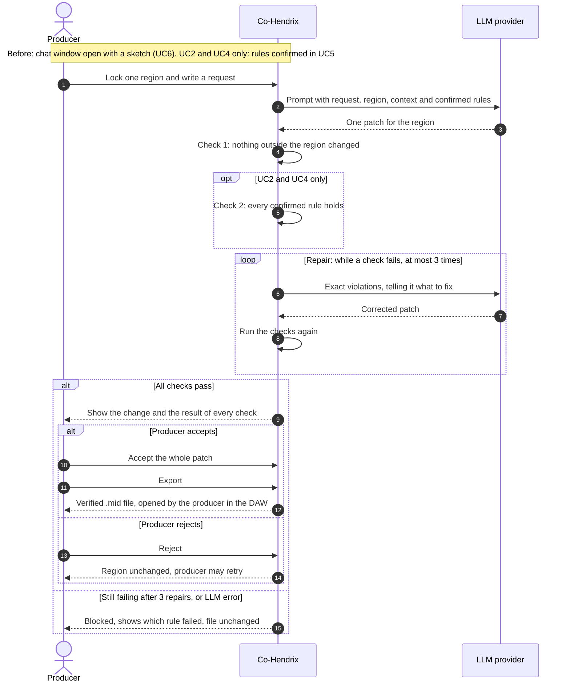
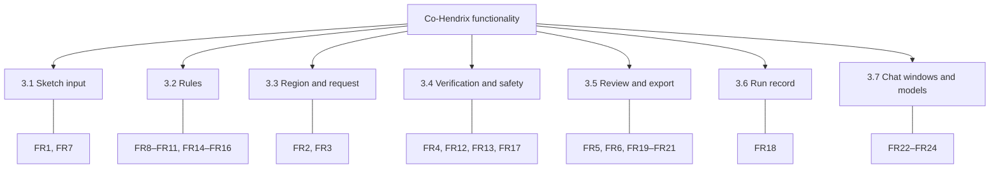

# Co-Hendrix — Application Requirements Document (ARD)

> **Draft status:** Abstract and Chapters 1–5 approved by the team. Appendices and the final pass (numbering, figures) are not written yet.

**Project:** Co-Hendrix — a verified AI tool that generates and edits multi-track MIDI within the rules you set

**Team:** Oren Kashani · Stav Ronen · Daniel Blanga · Eden Sabika

**Academic advisor:** Dr. Avi Segal

**Customer:** DJ LIRANO (Liron Goldvaser), producer and DJ

**Course:** SE Senior Project, Ben-Gurion University · November 2026

---

## Abstract

This document is the first of three documents describing the final project in the software engineering program. It describes the requirements of the software project *from the standpoint of the customer*.

Co-Hendrix is a verified AI tool that generates and edits multi-track MIDI within rules the producer sets. The producer uploads a MIDI sketch they wrote and locks exactly one region — specific tracks and bars — to work on. Rules can come from two sources. First, the producer can state constraints and limits in their own words, the same way they would talk to a chat assistant (for example, "keep the bass below C3" or "no notes on the off-beats"). Co-Hendrix turns each such statement into a rule it can check and shows it back to the producer. Second, the producer may attach 1–10 reference MIDI files of songs they like; from these files Co-Hendrix extracts key, pitch range and rhythm grid and suggests them as style rules. Reference files are optional: the producer can work with verbal constraints only, with suggested rules only, with both, or with neither. Whatever the source, nothing becomes a rule until the producer confirms it. The producer can work on several MIDI sketches at once, each in its own chat window with its own rules and history, and can choose which supported LLM model to use.

For each request, a cloud large language model (LLM) proposes exactly one patch for the locked region. Co-Hendrix does not trust that patch: it checks it in code. Notes outside the locked region must be unchanged, and every confirmed rule must hold. A patch that fails any check is blocked and is never applied, and the producer is told which rule failed. A patch that passes can be accepted or rejected as a whole, and the result is exported as a `.mid` file that the producer opens in their own digital audio workstation (DAW).

What Co-Hendrix guarantees: confirmed rules hold, and protected bars stay untouched. What it measures but does not promise: musical quality, originality, and fit to the producer's taste.

---

## Chapter 1 — Introduction

### 1.1 The Problem Domain

**Music production with MIDI.** Modern music is largely produced inside a digital audio workstation (DAW) such as Ableton Live, FL Studio or Logic Pro. Much of the musical material in a DAW is stored as MIDI: a symbolic description of the music — which note is played, when it starts, how long it lasts, and how hard it is played — organised in tracks (drums, bass, keys, and so on). Because MIDI describes notes rather than recorded sound, it can be read, edited and checked precisely by software. A typical way to start a song is to sketch a short idea of 8–16 bars across several tracks and then refine it by hand.

**AI assistance in production.** Producers increasingly use AI tools to help with these sketches: to continue an idea, to write a bass line under existing drums, or to vary a part they have already written. Most such tools are built on generative models, often large language models. Generative models are probabilistic: the same request can produce different outputs, and the model is not bound to follow every instruction it is given. For creative exploration this is useful. For editing work the producer has already shaped, it is a problem.

**Three problems producers face today.**

1. **Taste is lost.** A producer's style lives in songs they like, not only in a text prompt. Some limits are easy to say in words ("stay in A minor", "keep it sparse"), but today's tools treat even those as suggestions, and a groove or a register is hard to describe in words at all. As a result, AI output often ignores the producer's style.
2. **Edits leak.** When an AI tool is asked to change one part, it may also change bars the producer has already finished. The producer has to find and undo those changes by hand.
3. **No guarantees.** Nothing proves that the result still stays in the intended key, inside the instrument's note range, or on the intended rhythm grid. The producer has to check by ear or by eye.

**Existing tools.** AI MIDI tools exist, but none we found guarantee the edit. Table 1 summarises the closest tools, based on their public documentation as of November 2026; hands-on testing is planned for Sprint 1. A fuller survey appears in the appendix on similar products.

*Table 1 — Closest existing AI MIDI tools*

| Tool | What it does | What we did not find |
| --- | --- | --- |
| Suno Studio 2.0 | AI chat edits MIDI in its own web DAW | Declared rules, verification |
| MIDI Agent | LLM text-to-MIDI plugin; uses example files for style | Bar-scoped edits, verification |
| Staccato | Continues your MIDI; claims to learn your style | Protected bars, verification |
| Logic Session Players | Bass and keys follow the chord track | Prompts; works only in Logic |

**Where Co-Hendrix fits.** Co-Hendrix addresses the gap in the right-hand column of Table 1. It separates *generation*, which is left to an untrusted LLM, from *verification*, which is done by deterministic code. The producer declares the region and the rules — in their own words, or by confirming rules suggested from their reference songs — and the system enforces them. Protected bars stay untouched, rules are checked in code, and a patch that breaks a rule is never applied.

### 1.2 Context

Co-Hendrix does not replace any of the tools a producer already uses. It sits between the producer, the producer's DAW and an external LLM provider, and it is the only component that decides whether an AI-generated change may reach the producer's music. Figure 1 shows Co-Hendrix as a single block together with the external parties it works with.

*Figure 1 — Co-Hendrix in its environment*

Solid arrows: direct interfaces. Dashed arrows: files the producer moves by hand.

The external parties and the interfaces between them and Co-Hendrix are:

- **Producer (user).** An independent or small-studio MIDI producer and the only human who operates the system. The producer talks to Co-Hendrix directly: they select the region to work on, write requests and constraints in their own words, and confirm or edit the rules the system suggests ("prompts, confirmations" in Figure 1). Co-Hendrix answers with the edited result for the producer to accept or reject, or with an explanation of why the request failed and which rule was broken.
- **DAW.** The producer's existing workstation (for example Ableton Live, FL Studio or Logic Pro). Co-Hendrix has no direct connection to the DAW and is not a DAW plugin. The producer exports a sketch from the DAW as a `.mid` file and uploads it to Co-Hendrix; after accepting a result, they download the verified `.mid` file and open it in the DAW again. All hand-editing stays in the DAW: Co-Hendrix provides no built-in note editor.
- **Reference library.** Optional. A set of 1–10 MIDI files of songs the producer likes, uploaded by hand. Co-Hendrix uses them to suggest style rules (key, pitch range, rhythm grid) and may send them to the LLM as context for the producer's requests. They are stored with the chat window they were uploaded to and deleted with it.
- **LLM provider.** An external cloud service reached through its API. For each request, Co-Hendrix sends a prompt with the request, the locked region, the active rules and musical context — for example the other tracks, the surrounding bars and, when relevant, the reference songs — and receives back a proposed patch. The context helps the LLM fit its notes to the music; it does not widen what the patch may change. The provider is treated as untrusted: every patch it returns is verified by Co-Hendrix before the producer sees it as a valid result. The provider is swappable — Co-Hendrix is not tied to a specific model or vendor — and the producer can choose which supported model to use. The provider limits the cost and latency of each request.

Everything the producer can rely on — locked bars staying untouched and confirmed rules holding — is enforced inside the Co-Hendrix block, not by the LLM and not by the DAW.

### 1.3 Vision

**Our vision: AI MIDI edits you can trust.**

Co-Hendrix gives producers the speed of AI help without giving up control over their music. The producer stays in charge of *what* may change and *which rules* must hold; the AI only proposes; the system checks every proposal in code before it can reach the producer's file. The intended way of working has five steps:

1. **You set the rules.** The producer states the constraints the MIDI must be generated or edited by — in their own words, as they would to a chat assistant, or by confirming style rules that Co-Hendrix suggests from their reference songs. Nothing is a rule until the producer confirms it.
2. **You pick the part.** The producer chooses the tracks and bars to work on. Everything else is protected.
3. **The AI proposes.** An external LLM proposes one change for that part only — an edit of notes that are already there, or a new part in an empty section.
4. **The system verifies.** Co-Hendrix checks that no confirmed rule is broken and that every other part of the file is unchanged. A change that fails is blocked, and the producer sees why.
5. **Back to your DAW.** The verified change is exported as a `.mid` file and the producer continues working in their own DAW.

**Guaranteed:** the producer's confirmed rules hold, and protected bars stay untouched.

**Measured, not promised:** musical quality, originality, and fit to the producer's taste.

**Objectives.** To realise this vision, the project sets the following objectives:

- **Trust.** No AI change may alter notes outside the region the producer picked, and no change that breaks a confirmed rule may be applied.
- **Control.** The producer decides the region and the rules, and accepts or rejects each result as a whole.
- **Style without training.** Help the producer express their style through explicit rules — stated in words or suggested from songs they like — without claiming that the system learns their taste.
- **Fit the existing workflow.** Work with standard `.mid` files from any DAW, so the producer does not have to change tools.
- **Transparency.** When a change is blocked, tell the producer exactly which rule failed.

The customer will judge the result by the time it takes to reach an accepted edit, how many manual fixes are still needed afterwards, and whether they can trust that locked bars stay untouched.

### 1.4 Stakeholders

Table 2 lists the people and parties that are relevant to Co-Hendrix, what they want from it, and how much say they have on the requirements.

*Table 2 — Stakeholders*

| Stakeholder | Role | Interest | Say on requirements |
| --- | --- | --- | --- |
| **Customer — DJ LIRANO (Liron Goldvaser)**, producer and DJ | Represents the target users | AI help on MIDI sketches that does not break finished work or ignore their rules | Decides features, priorities and acceptance |
| **Independent / small-studio MIDI producers** | Primary end users | Faster sketching with AI, full control over what changes, files that open in their own DAW | Through the customer and user feedback |
| **Academic advisor — Dr. Avi Segal** | Supervises the project | A feasible, well-engineered and testable system | Reviews scope, architecture and progress |
| **Development team** — Oren Kashani, Stav Ronen, Daniel Blanga, Eden Sabika | Build and test the system | A scope that four students can deliver and verify in one academic year | Propose requirements; the customer decides |
| **Cloud LLM provider** | External service the system depends on | — (not a person) | Indirect: its capabilities, cost and latency limit what the system can do |

**Customer.** The customer is a working producer and DJ and acts as the voice of the target users. They decide which features matter most, set priorities, and accept or reject the delivered system. We expect the customer to give regular feedback on drafts and to provide sample sketches and reference songs for testing.

**End users.** The producers who use Co-Hendrix are the only human actors of the system (see Chapter 2). They are skilled in music and in their DAW but are not expected to be programmers or AI experts. In this version there are no administrator roles and no multi-user features: each producer works alone on their own files.

**External service.** The LLM provider does not take part in defining requirements, but the requirements must take it into account: the provider must be replaceable, and its cost and latency must be bounded.

### 1.5 Software Context

Co-Hendrix is an interactive tool. The producer works in chat windows. Each chat window holds one MIDI sketch, its reference files, the rules the producer has confirmed for it, the chosen LLM model, and the history of requests made on that sketch. The producer can open several chat windows, each editing a different MIDI sketch, and switch between them; windows are independent of each other and are saved until the producer deletes them. Each request goes through the same cycle: the producer picks a region and asks for a change; an LLM proposes a patch; Co-Hendrix verifies it; the producer accepts or rejects it. This section describes the major inputs, functionality, processing and outputs at a high level. Detailed scenarios are given in Chapter 2.

#### 1.5.1 Inputs

- **MIDI sketch.** A multi-track `.mid` file written by the producer and exported from their DAW, typically 8–16 bars.
- **Region.** The tracks and bars the producer allows to change in this request — exactly one region per request. The region may already contain notes (an edit) or be empty (a new part).
- **Request.** A short instruction in the producer's own words describing the change, for example: "Change only the bass in bars 5–8. Play more notes. Leave the drums."
- **Verbal constraints.** Limits the producer states in their own words, for example "keep the bass below C3". Co-Hendrix turns each one into a rule and shows it back for confirmation.
- **Reference MIDI files (optional).** 1–10 `.mid` files of songs the producer likes, used to suggest style rules and as context for the LLM.
- **Rule confirmations.** The producer's confirmation, edit or rejection of each suggested or stated rule.
- **Chord progression (optional).** A chord progression entered by hand. Co-Hendrix does not extract chords automatically.
- **Decision on the result.** Accept or reject a valid patch as a whole.

Co-Hendrix does not accept raw audio as input.

#### 1.5.2 Functionality

From the producer's point of view, Co-Hendrix offers the following capabilities:

1. **Manage chat windows** — open a new chat window for a sketch, switch between saved windows, choose the LLM model for a window, and delete a window.
2. **Import a sketch** — upload a `.mid` file into a chat window and see its tracks and bars.
3. **Set rules** — state constraints in words, and/or upload reference files and review the rules Co-Hendrix suggests from them (key, pitch range, rhythm grid). Confirm, edit or reject each rule. Only confirmed rules are enforced.
4. **Select a region** — lock the tracks and bars the request may change. Everything outside the region is protected.
5. **Ask for a change** — edit the notes already in the region, or generate a new part in an empty region.
6. **Review the result** — see and play back what changed in the region, and whether every check passed; if a check failed, see which rule failed.
7. **Accept or reject** — accept a valid patch as a whole, or reject it and keep the region as it was. The producer may then send a new request for the same region.
8. **Export** — download the verified result as a `.mid` file and continue in the DAW.

Co-Hendrix deliberately does not provide a built-in note editor: hand-editing stays in the producer's DAW.

#### 1.5.3 Processing

For each request, Co-Hendrix performs the following steps (without implementation details):

1. **Prepare the request.** Combine the producer's request, the locked region, the active rules and musical context into a prompt. The context may include the other tracks and the surrounding bars of the sketch and, when relevant, the window's reference songs. Context helps the LLM fit the new notes; it does not change what the patch may touch.
2. **Obtain a patch.** Ask the external LLM for exactly one patch: a set of note additions, removals and changes for the locked region only.
3. **Verify.** Check the patch in code, independently of the LLM:
   - no note outside the locked region is added, removed or changed;
   - every confirmed rule (for example key, pitch range, rhythm grid) holds.
4. **Repair or abstain.** If a check fails, Co-Hendrix returns the exact violations to the LLM — telling it what to fix — and asks for a corrected patch. It retries up to 3 times. If the patch still fails after the third repair, or the LLM returns an error, Co-Hendrix abstains: the patch is not applied, the file stays as it was, and the producer is told which rule failed.
5. **Present.** Show a verified patch to the producer for acceptance. Only an accepted, verified patch changes the sketch.
6. **Record.** Store a run record of the request — what was asked, which model was used, what the LLM returned, and the result of each check — so that the run can be reviewed, and its processing re-run on the stored LLM outputs.

Verbal constraints that cannot be expressed as a rule Co-Hendrix can check (for example "make it sound happier") are passed to the LLM as guidance only. Co-Hendrix tells the producer that such a constraint is not verified, and it is not part of the guarantee.

#### 1.5.4 Outputs

- **Result view.** The proposed change in the locked region, together with the outcome of every check.
- **Failure report.** When a request is blocked: which rule failed (for example "failed: key"), or that the LLM failed. The file is unchanged.
- **Suggested rules.** Key, pitch range and rhythm grid extracted from the reference files, for the producer to confirm.
- **Verified `.mid` file.** The updated sketch, downloaded by the producer and opened in their DAW.
- **Run record.** A record of each request and its result.

### 1.6 System Interfaces

#### 1.6.1 Hardware interfaces

Co-Hendrix has no special hardware interfaces. The producer uses an ordinary personal computer with a network connection. MIDI controllers and audio devices are used only inside the producer's DAW, not by Co-Hendrix.

#### 1.6.2 Software interfaces

- **Producer interface.** The interface through which the producer uploads files, states requests and constraints, confirms rules, reviews results, and downloads the exported file.
- **MIDI files.** Co-Hendrix reads and writes standard MIDI files (`.mid`). This is its only interface to the producer's DAW and to the reference library: files are moved by hand, and there is no plugin or live connection to any DAW.
- **LLM provider API.** Co-Hendrix sends prompts to an external cloud LLM over its API and receives proposed patches. The provider is swappable, and the producer chooses the model for each chat window from a list of supported models. The provider for the first sprint has not been chosen yet.

#### 1.6.3 Events

*Input events* (from the producer):

- A chat window is created, opened or deleted.
- An LLM model is selected for a chat window.
- A sketch is uploaded.
- Reference files are uploaded.
- A verbal constraint is stated.
- A suggested or stated rule is confirmed, edited or rejected.
- A region is selected.
- A request is submitted.
- A valid patch is accepted or rejected.
- An export is requested.

*External events* (from the LLM provider):

- A patch is returned.
- The provider returns an error, or does not respond in time.

*Output events* (to the producer):

- Suggested rules are ready for confirmation.
- A verified patch is ready for review.
- A request is blocked, with the reason.
- The exported file is ready to download.

---

## Chapter 2 — Usage Scenarios

This chapter describes the main ways producers use Co-Hendrix. The scenarios come from the requirements review with the customer. Each use case lists the requirements it covers (Chapter 3), and each alternative flow is meant to become an acceptance test.

### 2.1 User Profiles — The Actors

Actors are external to Co-Hendrix and exchange data with it. There is one human actor and two non-human actors.

**Producer (primary actor).** An independent or small-studio MIDI producer, working alone on their own files. They sketch multi-track MIDI ideas of 8–16 bars in a DAW and want AI help that does not damage finished work. They know music and their DAW well; they are not expected to know programming or how LLMs work. The producer is the only actor who starts use cases: they open chat windows, choose the model, upload sketches and reference files, state rules, select regions, make requests, and accept or reject results. There are no administrator roles and no multi-user features in this version.

**LLM provider (supporting actor).** An external cloud service. It receives a prompt from Co-Hendrix and returns a proposed patch, or an error. It may receive musical context, including the reference songs of the chat window, and its output is always verified before use. It does not start any use case.

**DAW (supporting actor).** The producer's own workstation. It has no live connection to Co-Hendrix: the producer moves `.mid` files between the DAW and Co-Hendrix by hand. It is the source of the sketch and the destination of the verified result.

### 2.2 Use Cases

Co-Hendrix supports two situations, each with or without confirmed rules (Table 3). A fifth use case, UC5, sets up the rules and is included by UC2 and UC4. A sixth, UC6, lets the producer open, switch and delete chat windows; every other use case takes place inside one chat window.

*Table 3 — Use-case map*

| | No confirmed rules | Confirmed rules |
| --- | --- | --- |
| **Edit an existing section** | UC1 | UC2 |
| **Generate a part in an empty section** | UC3 | UC4 |
| **Set up the rules** (preparatory stage) | — | UC5 (included by UC2 and UC4) |
| **Manage chat windows** | UC6 | UC6 |

Rules come from two sources: constraints the producer states in their own words, and style rules suggested from reference files. In every case, nothing is a rule until the producer confirms it.

*Figure 2 — Use-case diagram*

Dashed lines to the DAW: files the producer moves by hand.

**Common behaviour of UC1–UC4.** All four request use cases share the same safety behaviour:

- The producer locks exactly one region per request, and Co-Hendrix asks the LLM for exactly one patch for that region.
- Co-Hendrix verifies every patch in code. If a check fails, it returns the exact violations to the LLM and asks for a corrected patch, up to 3 times. If the patch still fails, or the LLM fails, Co-Hendrix abstains: nothing is applied, the file is unchanged, and the producer sees what failed.
- The producer accepts or rejects a valid patch only as a whole. After a rejection, the region stays as it was and the producer may send a new request for the same region.

Figure 3 shows one request from start to end. The same diagram serves all four request use cases; they differ only as follows:

- **Edit or generate.** In UC1 and UC2 the locked region already has notes and the patch changes them. In UC3 and UC4 the region is empty and the patch only adds notes.
- **Which checks run.** Check 1 (nothing outside the region changed) runs in all four. Check 2 (every confirmed rule holds) runs only in UC2 and UC4, where rules were confirmed in UC5. In UC1 and UC3 there are no confirmed rules, so step 5 is skipped.

*Figure 3 — Sequence diagram: one request (UC1–UC4)*

How to read Figure 3:

- Steps 1–3 are the request and the LLM's single patch.
- Steps 4–5 are the checks Co-Hendrix runs in code.
- The **loop** is the repair cycle from alternative flows 5.a in UC1–UC4. It runs only when a check fails, and at most 3 times.
- The outer **alt** shows the two possible endings: a valid patch that the producer accepts or rejects, or a blocked request (alternative flows 4.a and 5.b). In both cases nothing outside the locked region can change.

---

#### UC1 — Edit an existing section, no confirmed rules

**Primary actor:** Producer. **Supporting actors:** LLM provider, DAW.

**Description:** The producer changes notes that are already in the sketch, without any confirmed rules. Only the locked region is protected.

**Trigger:** The producer selects an existing section and asks Co-Hendrix to change it.

**Preconditions:**

1. The producer has loaded a MIDI sketch they wrote into a chat window.
2. The locked region already contains notes.
3. No rules have been confirmed.

**Main success scenario:**

1. The producer provides their MIDI sketch.
2. They lock one existing region (tracks and bars that already have notes).
3. They request a change in that region only.
4. Co-Hendrix asks the LLM for exactly one patch for that region.
5. Co-Hendrix checks that notes outside the locked region are unchanged.
6. The producer reviews the result and accepts the patch as a whole.
7. They export the `.mid` file and continue hand-edits in their DAW.

**Alternative flows:**

- **4.a The LLM fails** (error or no response). Co-Hendrix abstains: nothing is applied, the file is unchanged, and the producer is told the LLM failed.
- **5.a The patch changes notes outside the locked region.** Co-Hendrix sends the violation back to the LLM and asks for a corrected patch, up to 3 times. If a corrected patch passes, continue at step 6.
- **5.b Still failing after 3 repairs.** Co-Hendrix abstains: the patch is not applied, the file is unchanged, and the producer sees the violation.
- **6.a The producer rejects the valid patch.** The region stays as it was. The producer may send a new request for the same region (back to step 3).

**Postconditions:** Only the locked existing region changed. No rules were enforced other than protecting everything outside the region.

**Covered requirements:** FR1–FR8, FR13, FR17–FR21.

---

#### UC2 — Edit an existing section, with confirmed rules

**Primary actor:** Producer. **Supporting actors:** LLM provider, DAW.

**Description:** The producer changes notes that are already in the sketch, under rules they have confirmed.

**Trigger:** The producer selects an existing section and asks for a change under confirmed rules.

**Preconditions:**

1. The producer has loaded a MIDI sketch they wrote into a chat window.
2. The locked region already contains notes.

**Main success scenario** (example from the requirements review):

1. The producer provides an 8-bar MIDI sketch (drums and bass, in A minor).
2. The producer sets up rules (**include UC5**): they attach 2 reference MIDI files of songs they like; Co-Hendrix suggests key, pitch range and rhythm grid as rules, and the producer confirms them.
3. They lock the bass in bars 5–8 and request: "Change only the bass in bars 5–8. Play more notes. Leave the drums."
4. Co-Hendrix asks the LLM for exactly one patch for that region.
5. Co-Hendrix verifies the locked region and each confirmed rule.
6. All checks pass. The producer reviews the result and accepts the patch as a whole.
7. They export the `.mid` file and continue in their DAW.

Confirmed rules in this example: stay in A minor; stay in the bass's note range; stay on the rhythm grid; only bars 5–8 of the bass may change.

**Alternative flows:**

- **4.a The LLM fails.** Co-Hendrix abstains; the file is unchanged and the producer is told the LLM failed.
- **5.a A check fails** (example: the new bass uses a note that is not in A minor). Co-Hendrix sends the exact violation to the LLM ("bar 6: note not in A minor") and asks for a corrected patch, up to 3 times. If a corrected patch passes every check, continue at step 6.
- **5.b Still failing after 3 repairs.** The patch is not applied, the file is unchanged, and the producer sees which rule failed (for example "failed: key").
- **6.a The producer rejects the valid patch.** The region stays as it was; they may retry the same region (back to step 3).

**Postconditions:** Only the bass in bars 5–8 changed. Drums and bars 1–4 stayed the same. All confirmed rules hold.

**Covered requirements:** FR1–FR7, FR9–FR13, FR15, FR17–FR21 (FR14–FR16 through UC5).

---

#### UC3 — Generate a part in an empty section, no confirmed rules

**Primary actor:** Producer. **Supporting actors:** LLM provider, DAW.

**Description:** The producer asks Co-Hendrix to write new notes into an empty region, without any confirmed rules.

**Trigger:** The producer selects an empty section and asks Co-Hendrix to generate a part there.

**Preconditions:**

1. The producer has loaded a MIDI sketch they wrote into a chat window.
2. The locked region has no notes.
3. No rules have been confirmed.

**Main success scenario:**

1. The producer provides their MIDI sketch.
2. They lock an empty region (tracks and bars with no notes).
3. They ask Co-Hendrix to generate a new part in that region only.
4. Co-Hendrix asks the LLM for exactly one patch that fills only that region.
5. Co-Hendrix checks that existing notes outside the region are unchanged.
6. The producer reviews the new part and accepts it as a whole.
7. They export the `.mid` file and continue in their DAW.

**Alternative flows:**

- **4.a The LLM fails.** Co-Hendrix abstains; the section stays empty and the file is unchanged.
- **5.a The patch writes outside the empty region.** Co-Hendrix sends the violation to the LLM and asks for a corrected patch, up to 3 times. If a corrected patch passes, continue at step 6.
- **5.b Still failing after 3 repairs.** Co-Hendrix abstains; the section stays empty and the producer sees the violation.
- **6.a The producer rejects the patch.** The section stays empty. They may retry the same region (back to step 3).

**Postconditions:** New notes exist only in the previously empty region. The rest of the file is unchanged. No rules were enforced other than protecting everything outside the region.

**Covered requirements:** FR1–FR8, FR13, FR17–FR21.

---

#### UC4 — Generate a part in an empty section, with confirmed rules

**Primary actor:** Producer. **Supporting actors:** LLM provider, DAW.

**Description:** The producer asks Co-Hendrix to write new notes into an empty region, under rules they have confirmed.

**Trigger:** The producer selects an empty section and asks Co-Hendrix to generate a part there under confirmed rules.

**Preconditions:**

1. The producer has loaded a MIDI sketch they wrote into a chat window.
2. The locked region has no notes.

**Main success scenario:**

1. The producer provides their MIDI sketch.
2. The producer sets up rules (**include UC5**) — from 1–10 reference files, from constraints stated in their own words, or both — and confirms them.
3. They lock an empty region and ask Co-Hendrix to generate a new part there only.
4. Co-Hendrix asks the LLM for exactly one patch for that region.
5. Co-Hendrix verifies the locked region and each confirmed rule.
6. All checks pass. The producer reviews the new part and accepts it as a whole.
7. They export the `.mid` file and continue in their DAW.

**Alternative flows:**

- **4.a The LLM fails.** Co-Hendrix abstains; the section stays empty and the file is unchanged.
- **5.a A check fails.** Co-Hendrix sends the exact violations to the LLM and asks for a corrected patch, up to 3 times. If a corrected patch passes every check, continue at step 6.
- **5.b Still failing after 3 repairs.** The patch is not applied, the section stays empty, and the producer sees which rule failed.
- **6.a The producer rejects the valid patch.** The section stays empty; they may retry the same region (back to step 3).

**Postconditions:** The previously empty region contains a generated part that satisfies every confirmed rule. Everything else is unchanged.

**Covered requirements:** FR1–FR7, FR9–FR13, FR15, FR17–FR21 (FR14–FR16 through UC5).

---

#### UC5 — Set up and confirm rules

**Primary actor:** Producer. **Supporting actors:** none.

**Description:** The producer defines the rules that later requests must obey, by stating constraints in their own words, by attaching reference files and reviewing the rules Co-Hendrix suggests from them, or both.

UC5 is a preparatory stage, not a goal on its own: the producer sets up rules in order to make constrained requests afterwards. It is written as a separate use case because it is shared by UC2 and UC4 (it is included by both), it has its own interaction with the producer (suggest, confirm, edit, reject) and its own alternative flows, and it is tested separately from the request flow. Once set up, the rules stay active for the following requests in the same chat window, so the producer does not repeat UC5 before each request. Rules confirmed in one chat window do not apply in any other window.

**Trigger:** The producer wants Co-Hendrix to enforce rules on the next requests in the current chat window.

**Preconditions:**

1. The producer has loaded a MIDI sketch.

**Main success scenario:**

1. The producer attaches 1–10 reference MIDI files and/or states constraints in their own words (for example "keep the bass below C3").
2. For each reference file, Co-Hendrix extracts key, pitch range and rhythm grid and suggests them as rules.
3. For each verbal constraint, Co-Hendrix turns it into a rule it can check and shows the rule back to the producer in plain terms.
4. Optionally, the producer enters a chord progression by hand.
5. The producer confirms, edits or rejects each suggested and stated rule.
6. Co-Hendrix activates the confirmed rules for the following requests in this chat window.

**Alternative flows:**

- **1.a A file is not a valid `.mid`, or more than 10 reference files are attached.** Co-Hendrix rejects the upload and tells the producer why; files already accepted are kept.
- **1.b The producer attaches no reference files.** Skip step 2; only verbal constraints are used.
- **3.a A verbal constraint cannot be expressed as a rule Co-Hendrix can check** (for example "make it sound happier"). Co-Hendrix tells the producer that this constraint will be passed to the LLM as guidance only and will not be verified. It is not part of the guarantee.
- **5.a The producer rejects every rule.** No rule becomes active; later requests behave like UC1 or UC3.

**Postconditions:** The chat window's active rules are exactly the rules the producer confirmed. The reference files are stored with this chat window and may be sent to the LLM as context.

**Covered requirements:** FR9–FR11, FR14–FR16.

---

#### UC6 — Manage chat windows

**Primary actor:** Producer. **Supporting actors:** none.

**Description:** The producer works on several MIDI sketches at once, each in its own chat window. A chat window holds one sketch, its reference files, its confirmed rules, the chosen LLM model and the history of its requests. Windows are independent and are saved until the producer deletes them.

**Trigger:** The producer wants to start work on a new sketch, return to an earlier one, or remove one.

**Preconditions:** None.

**Main success scenario:**

1. The producer sees the list of their saved chat windows.
2. They open a new chat window and upload a MIDI sketch into it.
3. They choose the LLM model for this window from the list of supported models, or keep the default.
4. They work in the window (UC1–UC5).
5. They switch to another saved window; its sketch, rules, model and history are shown exactly as they left them.
6. Later, they return to the first window and continue where they stopped.

**Alternative flows:**

- **2.a The uploaded file is not a valid `.mid`.** Co-Hendrix rejects it and tells the producer why; the window stays empty.
- **5.a A request is still running in the window the producer leaves.** It continues; its result is waiting when the producer returns.
- **7. The producer deletes a window.** Co-Hendrix asks for confirmation, then deletes the window with its sketch, reference files, rules and history. Other windows are not affected.

**Postconditions:** Each saved chat window keeps its own sketch, reference files, rules, model and history. Nothing done in one window changes another.

**Covered requirements:** FR1, FR22–FR24.

> **Note on requirement numbers.** FR1–FR14 are the requirements agreed at the requirements review. FR15–FR24 are new; all requirements are defined in Chapter 3.

### 2.3 Special Usage Considerations

- **Files are moved by hand.** The producer must export their sketch from the DAW as a standard `.mid` file and import the verified file back. There is no live DAW connection.
- **Reference files go to the LLM.** Reference files may be sent to the external LLM provider as context for the producer's requests. Co-Hendrix stores them only with the chat window they were uploaded to.
- **One region, one request.** Each request may change exactly one region. Larger changes are made as a series of requests.
- **Results are not repeatable.** The LLM may return a different patch for the same request. What is guaranteed is that any result shown as valid passes every check, not that it is the same each time. Run records store the LLM's outputs, so a past request can be reviewed later without calling the LLM again.
- **Waiting for the LLM.** Each request depends on an external service and a network connection, and may take several seconds. Repairs add more LLM calls. If the LLM fails, the producer's file is never damaged.
- **Guarantees cover rules, not taste.** Co-Hendrix guarantees that confirmed rules hold and protected notes are unchanged. Whether the result sounds good is for the producer to judge.

---

## Chapter 3 — Functional Requirements

This chapter lists the capabilities Co-Hendrix must provide, written so that the customer can read them and each one can be tested. Requirements are grouped into seven functional areas (Figure 4). Each requirement has a stable identifier: FR1–FR14 were agreed at the requirements review and keep their numbers and wording; FR15–FR24 are new in this document. Section 3.8 lists possible upgrades (tagged EXT) that we do not commit to.

*Figure 4 — Functional areas*

In the tables below, *Source* says where a requirement comes from: **Review** — agreed at the 10 Nov 2026 requirements review; **New** — added in this document.

### 3.1 Sketch input

| ID | Requirement | Use cases | Source |
| --- | --- | --- | --- |
| FR1 | The system shall accept a MIDI sketch written by the producer. | UC1–UC4 | Review |
| FR7 | The system shall not accept raw audio as input. | UC1–UC4 | Review |

The sketch is a standard multi-track `.mid` file exported from the producer's DAW (see 1.6.2).

### 3.2 Rules

Rules are the constraints that every constrained patch must satisfy. They come from two sources — constraints the producer states in words, and style rules suggested from reference files — and in both cases they apply only after the producer confirms them.

| ID | Requirement | Use cases | Source |
| --- | --- | --- | --- |
| FR8 | When no style rules have been confirmed, the system shall not enforce extracted key, range, or rhythm-grid rules. | UC1, UC3 | Review |
| FR9 | The system shall accept between 1 and 10 reference MIDI files. | UC2, UC4, UC5 | Review |
| FR10 | The system shall extract key, pitch range, and rhythm grid from the provided MIDI and suggest them as style rules. | UC2, UC4, UC5 | Review |
| FR11 | The system shall activate a style rule only after the producer explicitly confirms it. | UC2, UC4, UC5 | Review |
| FR14 | The system shall allow an optional manually entered chord progression; it shall not extract chords automatically. | UC2, UC4, UC5 | Review |
| FR15 | The system shall accept constraints stated by the producer in their own words, translate each one into a rule of a type it can check, and show that rule back to the producer for confirmation. | UC2, UC4, UC5 | New |
| FR16 | When a stated constraint cannot be translated into a rule the system can check, the system shall tell the producer so, pass the constraint to the LLM as guidance only, and mark it "not verified". Such a constraint shall not be enforced and shall not block a patch. | UC5 | New |

Notes:

- Reference files are optional: a producer may confirm rules from stated constraints only (UC5, alternative flow 1.b). FR9 sets the limit when reference files are used.
- The rule types the system can check in this version are key, pitch range and rhythm grid, plus the locked region itself (FR2–FR4). A stated constraint such as "keep the bass below C3" becomes a pitch-range rule; "stay in D minor" becomes a key rule. A constraint of any other type, such as "max 4 notes per bar", falls under FR16 unless a possible upgrade adds that rule type (EXT1, section 3.8).
- FR11 applies to every rule, whatever its source: a rule from FR15 is active only after the producer confirms it.

### 3.3 Region and request

| ID | Requirement | Use cases | Source |
| --- | --- | --- | --- |
| FR2 | The system shall allow the producer to lock exactly one region (specified tracks and bars) per request. | UC1–UC4 | Review |
| FR3 | The system shall generate exactly one patch per request, and that patch shall affect only the locked region. | UC1–UC4 | Review |

A request is the producer's instruction in their own words. The region may contain notes (an edit, UC1 and UC2) or be empty (a new part, UC3 and UC4). In FR3, "one patch" is the single patch presented to the producer; corrected versions produced during repair (FR17) replace it and are not shown as separate options.

### 3.4 Verification and safety

| ID | Requirement | Use cases | Source |
| --- | --- | --- | --- |
| FR4 | The system shall leave all notes outside the locked region unchanged. | UC1–UC4 | Review |
| FR12 | The system shall verify every constrained patch against the locked region and each confirmed rule (key, range, rhythm grid). | UC2, UC4 | Review |
| FR13 | The system shall block any patch that fails a verification check, shall not apply it, and shall show the producer which rule failed. | UC1–UC4 | Review |
| FR17 | When a patch fails a verification check, the system shall send the exact violations back to the LLM and request a corrected patch, up to 3 times per request. If the patch still fails after the third repair, or the LLM returns an error, the system shall abstain: it shall apply nothing, leave the file unchanged, and report the reason to the producer. | UC1–UC4 | New |

Notes:

- FR12 covers every confirmed rule, including rules created from stated constraints (FR15) once confirmed.
- FR4 holds for every request, with or without rules: the locked-region check runs in UC1–UC4.
- Verification is done in the system's own code, not by the LLM.

### 3.5 Review and export

| ID | Requirement | Use cases | Source |
| --- | --- | --- | --- |
| FR5 | The system shall allow the producer to accept or reject a valid patch only as a whole. | UC1–UC4 | Review |
| FR6 | The system shall not provide a built-in editor; the producer shall continue hand-edits in their own DAW. | UC1–UC4 | Review |
| FR19 | Before the producer accepts or rejects a patch, the system shall show which notes the patch adds, removes and changes in the locked region, and the result of every check. | UC1–UC4 | New |
| FR20 | The system shall export the sketch, including accepted patches, as a standard `.mid` file. | UC1–UC4 | New |
| FR21 | Before the producer accepts or rejects a patch, the system shall let them play back the proposed result in the context of the sketch. | UC1–UC4 | New |

Note on FR20: rules are checked when a patch is verified (FR12, FR13), so a patch that breaks a rule never reaches the sketch. Export itself is never blocked. If the producer later adds or changes rules, notes already in the sketch are not re-checked, and the producer can still export the sketch even if it does not satisfy the new rules.

### 3.6 Run record

| ID | Requirement | Use cases | Source |
| --- | --- | --- | --- |
| FR18 | The system shall keep a run record for every request: the request, the locked region, the active rules, the LLM model used, each patch returned by the LLM, the result of each check, and the final outcome (accepted, rejected or blocked). | UC1–UC4 | New |

The run record makes every result explainable. Because it stores the LLM's outputs, the system's own processing of a past request can be re-run on them without calling the LLM again (see NFR9).

### 3.7 Chat windows and models

| ID | Requirement | Use cases | Source |
| --- | --- | --- | --- |
| FR22 | The system shall let the producer open several chat windows, each holding one MIDI sketch with its own reference files, confirmed rules, LLM model and request history, and switch between them. Nothing done in one window shall change another. | UC6 | New |
| FR23 | The system shall save each chat window, with its sketch, reference files, rules, model and history, until the producer deletes it. | UC6 | New |
| FR24 | The system shall let the producer choose, for each chat window, the LLM model to use from a list of supported models. | UC6 | New |

### 3.8 Possible Upgrades

The requirements FR1–FR24 above define the system we commit to. The course guidelines also ask us to suggest additional or more general functionality. The requirements below, tagged **EXT**, are possible upgrades that may follow once the committed requirements are in place. Which of them, if any, enter version 1.0 or a later version will be decided with the customer after this document is accepted.

| ID | Requirement (possible upgrade) | Why it could help |
| --- | --- | --- |
| EXT1 | The system shall support more rule types, chosen with the customer — for example a maximum number of notes per bar ("max 4 notes per bar"), maximum polyphony, or allowed note lengths. | More stated constraints could be verified instead of being passed as guidance only (FR16). |
| EXT2 | The system shall verify that new notes fit the manually entered chord progression (FR14). | Harmony is a common producer constraint; in the committed version the chord progression is guidance only. |
| EXT3 | The system shall keep a history of accepted patches in a chat window and allow the producer to undo them. | The producer could step back to an earlier version without re-importing a file. |
| EXT4 | The system shall offer several candidate patches per request, each verified, for the producer to choose from. | More choice without weakening any guarantee; it would change FR3, so it needs the customer's approval. |

### 3.9 Traceability

Table 4 maps each use case to the requirements it covers. Every requirement FR1–FR24 is covered by at least one use case.

*Table 4 — Requirements covered by each use case*

| Use case | Requirements |
| --- | --- |
| UC1 · Edit, no confirmed rules | FR1–FR8, FR13, FR17–FR21 |
| UC2 · Edit, with confirmed rules | FR1–FR7, FR9–FR13, FR15, FR17–FR21 |
| UC3 · Generate, no confirmed rules | FR1–FR8, FR13, FR17–FR21 |
| UC4 · Generate, with confirmed rules | FR1–FR7, FR9–FR13, FR15, FR17–FR21 |
| UC5 · Set up and confirm rules | FR9–FR11, FR14–FR16 |
| UC6 · Manage chat windows | FR1, FR22–FR24 |

---

## Chapter 4 — Non-functional Requirements

This chapter lists the constraints on how Co-Hendrix must behave, not what it does. Each requirement is quantified and has a test, so that it can be measured and demonstrated. The *Source* column says where a requirement comes from: **Review** — agreed at the 10 Nov 2026 requirements review; **Proposal** — from proposal v2 (7 Nov 2026), not restated at the review; **New** — added in this document.

Some targets cannot be set honestly before we have measured a first version. Following the requirements review, the cost and usability targets will be set after the Sprint 5 baseline. They are listed here with what will be measured, and marked *TBD (Sprint 5)*.

### 4.1 Implementation constraints

#### 4.1.1 Performance (speed, capacity, throughput)

| ID | Requirement | Target | How we test it | Source |
| --- | --- | --- | --- | --- |
| NFR1 | Time spent in our own code, from receiving the LLM's output to a verified result, for an 8-bar request | p95 < 2 s | Timings stored in each run record | Review |
| NFR2 | End-to-end time of a request, from submission to result, for an 8-bar request | < 60 s | Timings stored in each run record | Review |
| NFR3 | Import of reference MIDI files and rule suggestion | 1–10 files in ≤ 5 min | Import test with 10 reference files | Review |
| NFR4 | Size of one request | Up to 16 bars × 4 tracks | Tests with 8- and 16-bar, 4-track sketches | Proposal |
| NFR5 | LLM calls per request (1 initial patch + up to 3 repairs) | ≤ 4 | Counted in each run record; fault-injection mocks | Review |

NFR1 separates our own processing time from the LLM's time, because only our own code is under our control.

#### 4.1.2 Reliability and stability

| ID | Requirement | Target | How we test it | Source |
| --- | --- | --- | --- | --- |
| NFR6 | **Integrity.** Every applied patch leaves all notes outside the locked region unchanged and satisfies every confirmed rule; a patch that fails a check is never applied. | 100% | 10,000 random patches + end-to-end runs | Review (reworded, see note) |
| NFR7 | **Verifier correctness.** Each check (locked region, key, pitch range, rhythm grid) gives the correct verdict. | 100% of mutants and 100% of fixtures | Mutation suite and fixture suite in CI | Review (target raised, see note) |
| NFR8 | **Fault handling.** An LLM error, timeout or bad patch ends in abstain, never in a crash or a damaged file. | No crash; ≤ 4 LLM calls per request | Fault-injection mocks | Review |
| NFR9 | **Auditability.** Re-running the system's own processing of a past request on the LLM outputs stored in its run record — without calling the LLM again — gives the same verdicts and the same resulting sketch. | Identical result | Replay test in CI | Review |
| NFR10 | **File validity.** Every exported file is a valid standard MIDI file that opens in a DAW. | 100% of exports | Every export in CI is re-read and compared; manual check in a DAW | Proposal |

Note on NFR6: the review printed this row as "Protected notes untouched; violations block export". It is reworded to match FR20 — export is never blocked; instead, a patch that breaks a rule never reaches the sketch. The target and the test are unchanged.

Note on NFR7: the review printed "100% of mutants, ≥ 99% of fixtures". The fixture target is raised to 100% so that the guarantee "confirmed rules hold" is as strong as "protected bars stay untouched". This is possible because each rule is defined precisely (a key is a set of allowed pitch classes, a range is a lowest and highest note, a grid is a step size with a fixed tolerance), so every check is an exact computation, like the locked-region check.

NFR6 and NFR7 test different things. NFR6 is the outcome for the producer: nothing that breaks the region or a rule is ever applied. NFR7 tests the checks themselves, in two complementary ways:

- **Mutants** are deliberately broken patches generated automatically — for example a valid patch with one note moved into a locked bar, out of the key, out of the range or off the grid. Each check must flag every mutant aimed at it. This shows the checks do not miss violations.
- **Fixtures** are small hand-written test cases with a known correct verdict, including valid patches and edge cases (for example a note exactly on the highest allowed pitch). This shows the checks give the right answer in both directions, including not rejecting valid patches.

NFR6 and NFR7 are invariants, which is why their targets are 100% rather than, say, 95%: a single changed protected note, or a single applied note that breaks a confirmed rule, is a bug.

NFR9 does not ask the LLM to repeat itself — the LLM may answer the same prompt differently each time. It checks that our own code is deterministic: given the same stored LLM outputs, it always reaches the same verdicts and result. The LLM outputs are stored in the run record of each request (FR18), on the Co-Hendrix server.

#### 4.1.3 Safety and security

| ID | Requirement | Target | How we test it | Source |
| --- | --- | --- | --- | --- |
| NFR11 | **Privacy.** The producer's sketches and reference files are sent only to the LLM provider selected for the chat window, are stored only with that window on the Co-Hendrix server, and are deleted when the window is deleted. | No other destinations; nothing left after deletion | Test of outgoing requests; deletion test | Review (changed, see note) |
| NFR12 | **Credentials.** The LLM provider's API key is kept on the server side and is never sent to the producer's browser or written to a run record. | 0 occurrences | Test that inspects responses to the browser and stored run records | New |

Note on NFR11: the review stated that reference songs are never stored or sent to the LLM as notes. This document changes that: reference songs may be sent to the LLM as context, and are stored with their chat window (see 1.2).

There are no user accounts, roles or multi-user features in this version (see 1.4), so there are no access levels to enforce. One producer works with their own saved chat windows.

#### 4.1.4 Portability and interoperability

| ID | Requirement | Target | How we test it | Source |
| --- | --- | --- | --- | --- |
| NFR13 | Co-Hendrix is used through a web browser on a desktop computer; the producer installs nothing. | Works in current desktop Chrome, Firefox and Edge | End-to-end tests in each browser | Proposal (browsers: New) |
| NFR14 | The LLM provider is swappable, and the producer can choose the model per chat window (FR24). Adding a supported provider or model requires a configuration change only, with no change to the verification code. | 1 configuration change per model | Run the test suite against two models, or a model and a mock | Review |
| NFR15 | Co-Hendrix exchanges music only as standard MIDI files, so it works with any DAW that can import and export them. | Exported files open in Ableton Live, FL Studio and Logic Pro | Manual import test in each DAW | Review (DAW names: New) |
| NFR16 | The user interface and the producer's requests are in English. | English | — | New |

#### 4.1.5 Usability

Producers are expected to be fluent in music and in their own DAW. They are not expected to know programming, MIDI internals or how LLMs work, and should need no training beyond a short introduction.

Usability targets are *TBD (Sprint 5)*. The customer will judge usability by the measures below, and the targets will be set with the customer after the Sprint 5 baseline:

- time from the first request to an accepted edit;
- number of manual fixes the producer still makes in the DAW after accepting;
- in a blind comparison with the customer (10–12 tasks, with and without verification and suggested rules): acceptance rate, usefulness on a 1–5 scale, and time to an acceptable result.

#### 4.1.6 Availability

Co-Hendrix depends on an external LLM provider and on a network connection, and this project does not commit to an uptime figure. The requirement is about how the system behaves when the LLM is not available:

- requests that need the LLM end in abstain, with the reason shown, and the producer's file is unchanged (NFR8);
- importing a sketch, setting up and confirming rules, and exporting do not use the LLM and remain available.

#### 4.1.7 Cost

The cost of each request is mostly the LLM provider's charge. The cost target per request is *TBD (Sprint 5)*. To keep cost bounded, each request makes at most 4 LLM calls (NFR5), and the prompt includes only the context the request needs. The cost also depends on the model the producer chooses (FR24). The Sprint 1 LLM provider, and who pays for it, are still open.

#### 4.1.8 Measured quality (not guaranteed)

Musical quality, originality and fit to the producer's taste are measured, never promised. Proposal v2 planned the following measures. Their targets are provisional and will be confirmed after the Sprint 5 baseline.

| Measure | How computed | Provisional target |
| --- | --- | --- |
| Delivery rate | Requests that end with a verified patch ÷ all requests; abstaining counts as a failure | ≥ 70% |
| Value of repairs | Rule compliance after repairs vs. the LLM's first attempt | ≥ +20 percentage points |
| Key suggestion | The key the producer confirms is among the system's top 3 suggestions | ≥ 90% |

### 4.2 Platform constraints

The customer has not imposed a platform. The constraints below come from the requirements themselves:

- Generation must use an external cloud LLM through its API (1.2). The model is not hosted or trained by us.
- Verification and rule suggestion must not use the LLM or any other AI: they are deterministic code, so that their results can be tested exactly (FR12, NFR7, NFR9).
- Co-Hendrix must not be a DAW plugin and must not depend on any DAW's API (1.6.2).

Proposal v2 planned the following technologies. They are planning choices, not customer constraints; the final choice belongs in the design document (ADD):

- web client in React and TypeScript, with Tone.js for playback;
- server in Python with FastAPI and Pydantic;
- MIDI reading and writing with mido and pretty_midi, and key analysis with music21;
- PostgreSQL for chat windows, rules, patches and run records;
- LiteLLM as the interface to swappable LLM providers;
- Docker and GitHub Actions for deployment and CI.

#### 4.2.1 SE project constraints

- **Team and schedule.** Four students, in two-week sprints, with final delivery in June 2027. A first thin slice through every module (the Alpha) is due in week 7; it is described in Chapter 5.
- **Interactive system.** Co-Hendrix is interactive: inputs come from a real producer through the browser. No device needs to be simulated.
- **Test data.** We will use real MIDI sketches and reference files, provided by the customer and by the team, plus generated fixtures for automated tests (for example random patches and one-note mutants).
- **The LLM in testing.** Automated tests and CI use a mock LLM that returns recorded or injected outputs, so that tests are repeatable and free. Real-LLM runs are done on demand and reported, not used as a CI gate. Every merge must pass linting, type checks, unit and mutation tests, integration tests and a mock end-to-end run.
- **LLM cost.** Real-LLM runs cost money. The provider and who pays are still open (see 4.1.7).
- **Final demonstration.** The demo will run live on a real LLM with real files:
  1. Import a 4-track sketch exported from a DAW.
  2. Attach reference files and confirm the suggested rules; add one stated constraint in words. Open a second chat window with another sketch to show that windows are independent.
  3. Lock a region and make a request that leads the LLM to break a rule (for example the key).
  4. Show the violation being reported to the LLM and repaired, then the verified result, with the locked bars unchanged.
  5. Accept the patch, export the `.mid` file, and open it in a DAW.
  6. Show a request that still fails after 3 repairs being blocked, with the file unchanged.

### 4.3 Special restrictions and limitations

**Assumptions.** The requirements above assume that:

- the producer's DAW can export and import standard MIDI files;
- a network connection and at least one LLM provider are available;
- sketches are short ideas of about 8–16 bars, edited one region at a time.

**Limitations by design.** In this version Co-Hendrix:

- does not accept raw audio and does not extract chords automatically (FR7, FR14);
- does not provide a note editor and is not a DAW plugin (FR6);
- has no administrator roles and no multi-user features;
- does not claim to learn the producer's taste, and does not guarantee musical quality;
- does not give the same result twice for the same request; it guarantees only that every result it shows as valid passes every check.

**Standards.** Co-Hendrix reads and writes files in the Standard MIDI File format.

---

## Chapter 5 — Risk Assessment and Plan for the Proof of Concept

This chapter lists the main risks to the project, says when each one will be checked and what we will do if it happens, and describes the proof of concept — the Alpha — that we will build first to reduce the most serious of them.

### 5.1 Risk register

Each risk has a probability (P) and an impact (I) — H high, M medium, L low — a date by which we check it, a mitigation that lowers it, and a fallback if it happens anyway. The *Source* column says where the risk comes from: **Review** — on the requirements-review deck; **Proposal** — from proposal v2; **New** — added in this document, mostly because of the scope changes made while writing it. The owner is the team member responsible for watching the risk and starting the fallback.

*Table 5 — Risk register*

| ID | Risk | P / I | We check | Mitigation | Fallback | Owner | Source |
| --- | --- | --- | --- | --- | --- | --- | --- |
| R1 | LLM patches fail the constraints too often to be useful | H / H | Sprint 5 baseline (raw LLM, no repairs) | Up to 3 structured repairs with the exact violations (FR17); context in the prompt | Template composer (bass roots, arpeggios, drum patterns) behind the same patch format, still verified | TBD | Review |
| R2 | Competing AI MIDI tools (for example Suno Studio) add rule checking or protected regions, narrowing what sets Co-Hendrix apart | M / H | Hands-on tests, Sprints 1–2; their releases, every milestone | Build our edge where they are weakest today: verification in code, protected bars, run records | Re-focus with the customer on the features that still set Co-Hendrix apart | TBD | Review (reworded) |
| R3 | Verbal constraints are translated into the wrong rule | L / H | Sprint 5, on a set of test phrases | Every rule is shown back in plain terms and is active only after confirmation (FR11, FR15) | The producer picks the rule type and value from a short form instead of words | TBD | New |
| R4 | Key suggestion is wrong on short or sparse MIDI | M / M | Sprint 5, labelled fixtures | Show the top 3 key guesses; the producer picks or enters the key | Manual entry only | TBD | Proposal |
| R5 | Latency or LLM cost per request is too high | M / M | Sprint 5 baseline | At most 4 LLM calls per request (NFR5); only the context the request needs; budget caps | Default to a faster or cheaper supported model (FR24) | TBD | Proposal |
| R6 | Modules fail to integrate | M / H | Thin slice, Sprint 3 (the Alpha) | Frozen Score and Patch schemas; contract tests in CI | An integration-only sprint | TBD | Review |
| R7 | The rule types we can check are too narrow to matter to producers | M / M | Customer review, Sprints 1–2 | Start with the rules the customer ranks highest; rule types designed to be added (EXT1) | Add the customer's top missing rule type before other features | TBD | Proposal |

R1, R2 and R6 are the three risks on the requirements-review deck; R2 is reworded. The other four are added here.

The most serious risks are R1 (technical: whether the LLM can produce valid patches at all) and R6 (integration: whether the modules work together). The proof of concept below is aimed at R6 directly and at R1 in part.

### 5.2 The proof of concept — Alpha, week 7

**Goal.** One real file, one constraint, one real LLM, through every module. The Alpha is a single thin slice through the whole system, not many half-finished features.

**Flow.**

1. Import a `.mid` file with 4 tracks.
2. Profile it: key and tempo.
3. Protect bars and ask for an edit.
4. The LLM returns a patch.
5. Check the protected bars (constraint C1).
6. Show the difference and export a `.mid` file.

If C1 fails, the system abstains and shows the violation. There is no repair loop yet: a patch that touches a protected bar is blocked, and showing that is part of the demo.

**Also built.**

- Score and Patch schemas, frozen.
- A run record for every request.
- CI with a mock LLM, end to end.

**Not yet in the Alpha.**

- The repair loop, and constraints C2–C4 (key, range, grid).
- The template-composer fallback.
- Verbal constraints, chat windows and model choice.

**Done when.**

- Protected bars are identical in 100% of mock runs.
- The exported file opens in a DAW.
- One live run on a real LLM succeeds.

We chose C1 for the Alpha because protected bars are our central promise and the simplest to check exactly.

### 5.3 How the proof of concept reduces risk

The course guidelines ask what the proof of concept will give us. Table 6 answers for the Alpha.

*Table 6 — What the Alpha gives us*

| The proof of concept should give | How the Alpha gives it |
| --- | --- |
| Better understanding of requirements | The customer sees a real edit on a real file, with protected bars kept, and can say early what matters most to them (R7). |
| Understanding of new technologies | One live run on a real LLM shows whether it can return a patch in our format at all, and how long it takes (R1, R5). |
| Early assessment of design decisions | Freezing the Score and Patch schemas, and running every module end to end, tests the module boundaries before the modules grow (R6). |
| The customer can visualise the final solution | The demo shows the full cycle the producer will use: import, protect, ask, check, see the change, export to the DAW. |
| Reduced risk of project failure | The highest integration risk (R6) is retired in week 7, and the LLM risk (R1) gets its first real data point before the Sprint 5 baseline. |

### 5.4 After the proof of concept

Proposal v2 planned the rest of the year in two-week sprints. The milestones below show when the remaining risks are checked.

*Table 7 — Milestones*

| Milestone | When | Content | Risks checked |
| --- | --- | --- | --- |
| M1 — Contracts and validation | Nov · Sprints 1–2 | Customer interviews; hands-on competitor tests; Score, Patch and Rule schemas frozen | R2, R7 |
| M2 — Thin slice (the Alpha) | Dec · Sprints 3–4 | One rule, one region edit, change view, end to end; CI and mocks | R6 |
| M3 — Verifier and rule suggestion | Jan · Sprints 5–6 | Key, range and grid checks; rule suggestion from references; raw-LLM baseline, after which the TBD targets are set | R1, R3, R4, R5 |
| M4 — Repair loop and fallback | Feb · Sprints 7–8 | Repair loop; template composer; verbal constraints | R1, R3 |
| M5 — Version 1.0 gate | Mar · Sprints 9–10 | Full interface, chat windows, model choice, run records; acceptance demo with the customer | — |
| M6 — Evaluation and hardening | Apr–May · Sprints 11–14 | Measured-quality suite, blind comparison with the customer, possible upgrades if time allows | — |

Final delivery is in June 2027.
